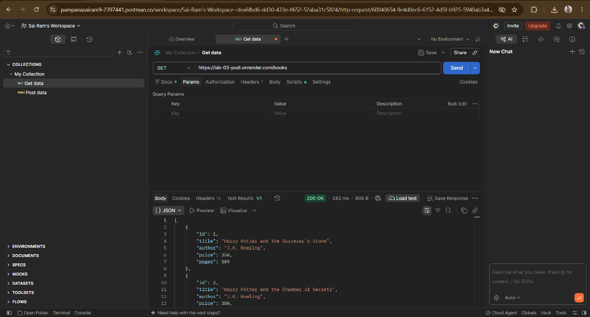
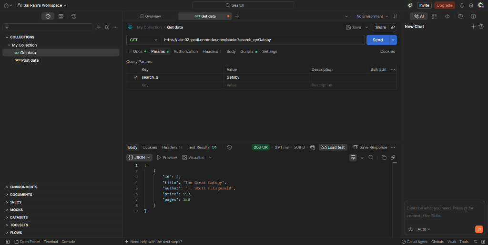
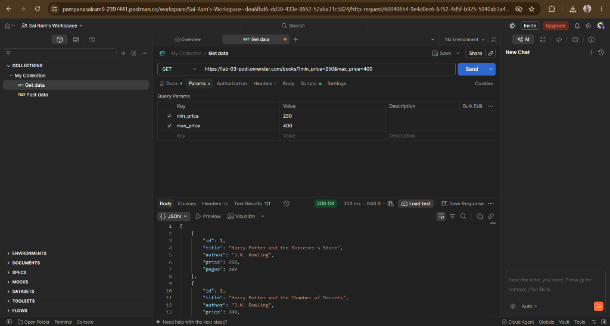
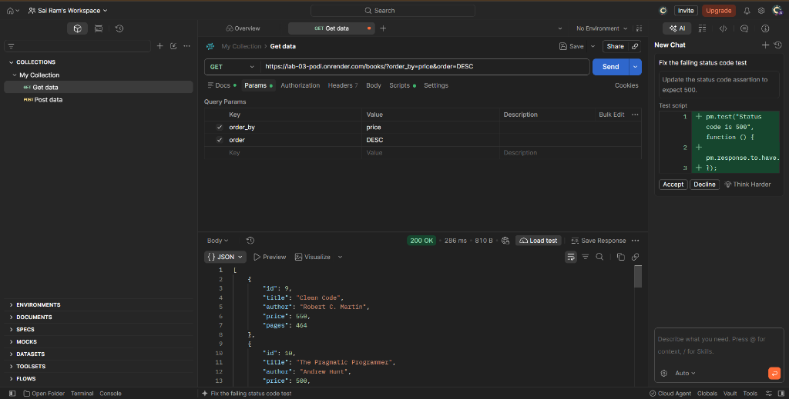
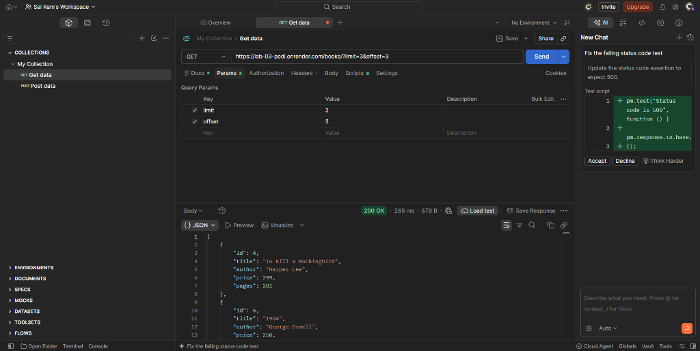

# Lab 3: REST API, Query Parameters, Validation, and Debugging

**Student Name:** P.ABHAYA SATYA SAI RAM  
**Registration Number:** 252U1R9114  
**Class/Section:** CSE(GEN)-AI-2B  
**College:** Aurora Higher Education and Research Academy  

**Live Link (Render):** [https://lab-03-podi.onrender.com](https://lab-03-podi.onrender.com)  
**API Base URL:** [https://lab-03-podi.onrender.com/books](https://lab-03-podi.onrender.com/books)  
**GitHub Repository:** [https://github.com/sairam-142008/LAB-03](https://github.com/sairam-142008/LAB-03)

---

## Project Overview

A robust RESTful API built with **Node.js**, **Express.js**, and **SQLite** for managing a books catalog. Implements complete CRUD operations, query parameter filtering (partial title search, sorting by allowed fields, pagination, and price range filtering), strict input validation with HTTP 400 status codes and uniform JSON error messages, parameterized queries to guard against SQL injection, asynchronous SQLite execution via Promises, and solutions to common debugging exercises.

## Objectives

- Design clean RESTful endpoints using nouns (`/books`) with HTTP methods (`GET`, `POST`, `PUT`, `DELETE`).
- Implement query parameter features: `search_q` (LIKE pattern), `order_by`, `order` (ASC/DESC), `limit`, `offset`, `min_price`, and `max_price`.
- Validate client requests and issue appropriate HTTP status codes (200, 201, 400, 404, 500).
- Safeguard the database using parameterized SQL queries against SQL injection attacks.
- Handle asynchronous database operations correctly without unhandled Promise rejections or missing awaits.
- Practise resolving core backend debugging scenarios: port conflicts (`EADDRINUSE`), broken module paths, table typos, and unawaited async calls.

## Technology Stack

| Technology | Purpose |
|------------|---------|
| Node.js | Asynchronous JavaScript runtime |
| Express.js | Web framework for routing and middleware |
| SQLite3 | Embedded SQL database engine (`sqlite3@5.1.7`) |
| Postman | Manual and automated API test verification |
| Git & GitHub | Source code tracking and remote version control |
| Render | Cloud hosting and continuous deployment |

## Project Structure

```
BDF_Lab_03/
│
├── index.js              # Express app, SQLite DB initialization, CRUD & query handlers
├── package.json          # Project metadata, dependencies, scripts
├── package-lock.json     # Locked dependency tree
├── books.db              # SQLite database file (auto-created)
├── README.md             # Complete documentation and testing evidence
├── test_runner.js        # Automated CLI test suite (63/63 passing tests)
├── .gitignore            # Git exclusion rules (node_modules, .env, *.db)
└── screenshots/          # Postman test execution evidence
    ├── render-01-get-all-books.png
    ├── render-02-search-gatsby.png
    ├── render-03-price-filter.png
    ├── render-04-sort-price-desc.png
    └── render-05-pagination.png
```

---

## Database Schema

**Table:** `book`

| Column | Type | Constraints | Description |
|--------|------|-------------|-------------|
| `id` | INTEGER | PRIMARY KEY AUTOINCREMENT | Unique identifier for each book record |
| `title` | TEXT | NOT NULL | Title of the book |
| `author` | TEXT | NOT NULL | Full name of the author |
| `price` | REAL | — | Retail price of the book |
| `pages` | INTEGER | — | Total page count |

### Seed Records (10 Books)

```sql
INSERT INTO book (title, author, price, pages) VALUES
('Harry Potter and the Sorcerer''s Stone', 'J.K. Rowling', 350, 309),
('Harry Potter and the Chamber of Secrets', 'J.K. Rowling', 380, 341),
('The Great Gatsby', 'F. Scott Fitzgerald', 199, 180),
('To Kill a Mockingbird', 'Harper Lee', 299, 281),
('1984', 'George Orwell', 250, 328),
('Pride and Prejudice', 'Jane Austen', 220, 432),
('The Alchemist', 'Paulo Coelho', 310, 197),
('Sapiens', 'Yuval Noah Harari', 450, 443),
('Clean Code', 'Robert C. Martin', 550, 464),
('The Pragmatic Programmer', 'Andrew Hunt', 500, 352);
```

> **Idempotent Seeding:** When the application starts, it verifies whether records exist in `book`. If the count is 0, the seed entries are populated automatically without duplicating rows on subsequent restarts.

---

## REST API Endpoints

| Method | Endpoint | Description | Success Code |
|--------|----------|-------------|--------------|
| `GET` | `/` | API status and route discovery index | 200 OK |
| `GET` | `/books` | Retrieve list of books with query parameters | 200 OK |
| `GET` | `/books/:bookId` | Retrieve a specific book by ID | 200 OK |
| `POST` | `/books` | Create a new book record | 201 Created |
| `PUT` | `/books/:bookId` | Update an existing book record | 200 OK |
| `DELETE` | `/books/:bookId` | Delete a book record by ID | 200 OK |

---

## Query Parameters (`GET /books`)

| Parameter | Type | Default | Description | Example |
|-----------|------|---------|-------------|---------|
| `search_q` | String | *none* | Case-insensitive partial title match (`LIKE '%...%'`) | `?search_q=Harry` |
| `order_by` | String | `id` | Allowed sort column: `id`, `title`, `author`, `price`, `pages` | `?order_by=price` |
| `order` | String | `ASC` | Sort direction: `ASC` or `DESC` | `?order=DESC` |
| `limit` | Integer | `10` | Maximum number of book records returned | `?limit=5` |
| `offset` | Integer | `0` | Number of book records to skip for pagination | `?offset=5` |
| `min_price` | Number | *none* | Lower bound price filter (`price >= min_price`) | `?min_price=200` |
| `max_price` | Number | *none* | Upper bound price filter (`price <= max_price`) | `?max_price=400` |

### Combined Query Example:
```
GET /books?search_q=Harry&order_by=price&order=ASC&limit=5&offset=0&min_price=300&max_price=500
```

---

## Input Validation Rules

| Input | Rule | Error Status | Error Response |
|-------|------|--------------|----------------|
| `title` | Required, non-empty text | 400 Bad Request | `{"message": "Title is required."}` |
| `author` | Required, non-empty text | 400 Bad Request | `{"message": "Author is required."}` |
| `price` | Required, numeric value | 400 Bad Request | `{"message": "Price must be a valid number."}` |
| `pages` | Required, positive integer | 400 Bad Request | `{"message": "Pages must be a valid positive integer."}` |
| `:bookId` | Path param, positive integer | 400 Bad Request | `{"message": "Book ID must be a valid positive integer."}` |
| `order_by` | In `['id','title','author','price','pages']` | 400 Bad Request | `{"message": "Invalid order_by value. Allowed values: id, title, author, price, pages."}` |
| `order` | In `['ASC','DESC']` | 400 Bad Request | `{"message": "Invalid order value. Use ASC or DESC."}` |
| `limit` | Positive integer (> 0) | 400 Bad Request | `{"message": "Limit must be a positive integer."}` |
| `offset` | Non-negative integer (>= 0) | 400 Bad Request | `{"message": "Offset must be a non-negative integer."}` |
| `min_price` > `max_price` | min_price cannot exceed max_price | 400 Bad Request | `{"message": "min_price must not exceed max_price."}` |

---

## HTTP Status Codes

- **200 OK** — Successful `GET`, `PUT`, or `DELETE` requests.
- **201 Created** — Successful `POST` creating a new book resource.
- **400 Bad Request** — Invalid client input, malformed numbers, or disallowed query parameters.
- **404 Not Found** — Targeted book ID does not exist in the database.
- **500 Internal Server Error** — Uncaught server/database execution failure.

---

## Debugging Exercises & Solutions

### 1. Port Conflict (`EADDRINUSE`)
- **Error:** `Error: listen EADDRINUSE: address already in use :::3000`
- **Cause:** Another node instance or application is already occupying TCP port 3000.
- **Identification:** Check active ports via `netstat -ano | findstr :3000` (Windows) or `lsof -i :3000` (Linux/macOS).
- **Solution:** Terminate the occupying process with `taskkill /PID <PID> /F` or configure dynamic port binding using `const PORT = process.env.PORT || 3000;`.

### 2. Wrong Import Path (`MODULE_NOT_FOUND`)
- **Error:** `Error: Cannot find module './databse'`
- **Cause:** Typographical mistake in file name or relative directory level in a `require(...)` call.
- **Identification:** Node stack trace highlights the erroneous path and indicates module resolution failure.
- **Solution:** Correct path spelling to `./database` and ensure correct relative paths (`./` vs `../`).

### 3. Table-Name Typo (`no such table`)
- **Error:** `SQLITE_ERROR: no such table: books`
- **Cause:** Discrepancy between table declaration (`CREATE TABLE book`) and query reference (`SELECT * FROM books`).
- **Identification:** SQLite error message explicitly specifies the missing table name.
- **Solution:** Standardize the model/table name (e.g., singular `book`) across all SQL statements.

### 4. Missing `await` in Asynchronous Database Calls
- **Error:** Endpoint returns `Promise { <pending> }` or empty response `{}` instead of database rows.
- **Cause:** Calling an async Promise-wrapped SQLite helper without using the `await` keyword causes Express to send a response before the database operation finishes.
- **Identification:** Inspect logs or response bodies where promises are directly serialized.
- **Solution:** Always prefix database helper invocations with `await` within `async` Express route handlers.

---

## How to Install and Run Locally

```bash
# Clone the repository
git clone https://github.com/sairam-142008/LAB-03.git
cd LAB-03

# Install dependencies
npm install

# Start local server
npm start
```
Server runs on: `http://localhost:3000`

### Run Automated Tests

In a separate terminal while the server is active:
```bash
npm test
```
All **63 test assertions** will execute and report pass/fail status.

---

## Deployment on Render

This project is deployed as a live Web Service on Render:
- **Build Command:** `npm install`
- **Start Command:** `npm start`
- **Environment:** Node.js
- **Port:** Configured via `process.env.PORT`
- **Live URL:** [https://lab-03-podi.onrender.com](https://lab-03-podi.onrender.com)

> **Storage Notice:** Render free tier web services utilize ephemeral filesystem storage. The SQLite database is re-initialized and seeded on every cold start or redeploy.

---

## Postman Testing Evidence (Screenshots)

### 1. Live Render - GET /books


### 2. Live Render - Search by Title (Gatsby)


### 3. Live Render - Price Range Filter (250 to 400)


### 4. Live Render - Sort by Price DESC


### 5. Live Render - Pagination (limit=3, offset=3)


---

## Viva Preparation Guide

**1. Query parameters vs. Path parameters?**  
- **Path parameters** (`/books/:bookId`) identify a specific, singular resource in the hierarchical resource tree.
- **Query parameters** (`/books?search_q=Harry&order_by=price`) filter, sort, paginate, or modify the representation of the collection without changing the resource identifier.

**2. What does stateless mean in REST?**  
- Every client HTTP request must contain all the context, authentication, and state required to satisfy the request. The server retains no client session context across roundtrips.

**3. What status code is appropriate for bad user input vs. a missing record?**  
- **HTTP 400 Bad Request** is returned when client input fails schema, type, or constraint validation.
- **HTTP 404 Not Found** is returned when valid query syntax targets a specific resource identifier that does not exist in the database.
